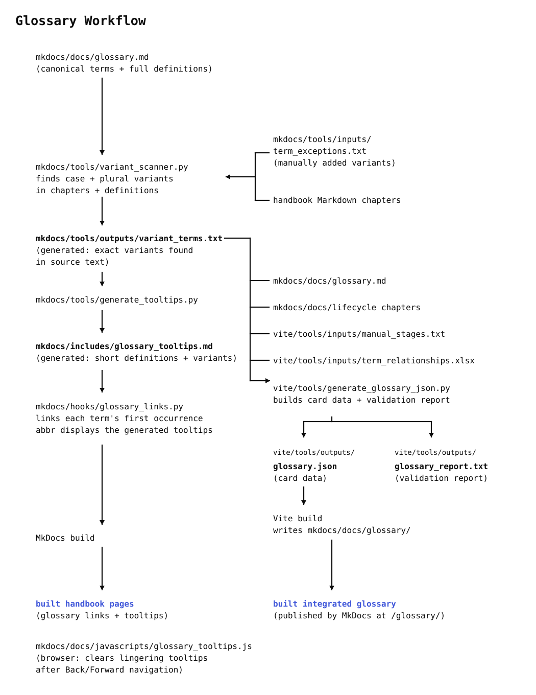

# CaRCC AI Facilitation Handbook — Integrated Glossary Test

[](https://squidfunk.github.io/mkdocs-material/)
[](https://vite.dev/)
[](https://ionicframework.com/)
[](https://github.com/robertpainsi/filtering.js)

## Summary

A test implementation of the [CaRCC AI Facilitation Handbook](https://carcc.github.io/ai-handbook/) with an integrated, interactive glossary. MkDocs and Material build the handbook; Vite and Ionic Core build the glossary at `/glossary/`. The first eligible mention of a term on each handbook page links to its glossary card and shows a short tooltip on desktop. Readers can search glossary terms, filter by AI lifecycle stage, and follow links between related concepts. The original Markdown glossary remains the source of all definitions.

## Live Test Site

[The CaRCC AI Handbook Glossary - Frankenstein](https://lebriggs.github.io/carcc-ai-handbook-glossary-frankenstein/glossary/)

## How The Glossary Works

The `abbr` Markdown extension displays tooltips generated from the first sentence of each definition in `glossary.md`. An ending `[...]` indicates that more text follows. `glossary_links.py` links the first occurrence of each canonical term (or its variants) on a handbook page to its glossary card. The limit is controlled by `MARKS_PER_PAGE` (`0` means unlimited); longer overlapping terms are matched first.

`variant_scanner.py` finds capitalization and plural variants in handbook chapters and definitions, along with manually supplied exceptions. Only variants actually found in the source text are kept. `update_terms.py` runs this scanner and then `generate_tooltips.py`.

### Exclusions For Term Links

Glossary links are not added to:

- headings
- table header cells
- terms that are already inside another link
- reference footnotes
- a glossary term within its own definition, including its variants

## Integrated Glossary

The integrated glossary displays alphabetically arranged cards with letter headings.

- **Search:** case-insensitive prefix match on canonical term names only; `model` finds *Model training*, not *Foundation model*.
- **Lifecycle filters:** multiple selected stages use OR; search further narrows the results. Stage chips on cards also work as filters.
- **Curated relationships:** parent–child and peer links, including their labels and display order, come from `term_relationships.xlsx`. The generator creates both directions; labels are not hardcoded.
- **Definition links:** additional term links are generated from definitions, excluding self-links and pairs already represented by curated relationships. `MARKS_PER_DEFINITION` sets the per-term limit.
- **Navigation:** clicking a relationship or definition link clears active filters before jumping to its card. Direct URLs such as `/glossary/#gpu` work, and the Handbook button returns to the handbook.

The `term_relationships.xlsx` workbook has three sheets: `term_relationships` (pairs and direction-specific labels), `Labels` (display order), and `Definitions` (editorial guidance, not used by the generator). The glossary uses filtering.js for filters and Markdown-it to render definitions.

## Workflow

The glossary looks simple to a reader. Hover over a term, see the tooltip, and click through to the definition. Behind the scenes, it's a tiny bureaucracy of text processing.



**Figure 1:** Glossary workflow from source files to the built handbook and integrated glossary. Black bold text marks generated intermediate files; blue bold text marks built site outputs.

## Files

All paths are relative to the repository root.

### MkDocs

- `mkdocs/docs/glossary.md` — canonical terms and definitions; not published as a separate page.
- `mkdocs/tools/inputs/term_exceptions.txt` — manually supplied variants.
- `mkdocs/tools/variant_scanner.py` → `mkdocs/tools/outputs/variant_terms.txt` — recognized variants.
- `mkdocs/tools/generate_tooltips.py` → `mkdocs/includes/glossary_tooltips.md` — tooltip definitions.
- `mkdocs/tools/update_terms.py` — runs both scripts above in order.
- `mkdocs/hooks/glossary_links.py` — adds handbook-to-glossary links.
- `mkdocs/docs/javascripts/glossary_tooltips.js` — clears stuck tooltips after Back/Forward navigation.
- `mkdocs/mkdocs.yaml` — handbook configuration and iintegrated glossary route.

### Vite

- `vite/tools/inputs/manual_stages.txt` — lifecycle assignments for terms not found automatically in chapters.
- `vite/tools/inputs/term_relationships.xlsx` — curated relationships, labels, and priorities.
- `vite/tools/generate_glossary_json.py` → `vite/tools/outputs/glossary.json` and `glossary_report.txt` — card data and validation report.
- `vite/src/main.js` — search, filtering, layout, and navigation.
- `vite/src/card/glossary_card.js` — card content and relationship links.
- `vite/src/css/` — glossary styles.
- `vite/package.json` — JavaScript dependencies and build commands.
- `mkdocs/docs/glossary/` — generated integrated glossary; do not edit directly.

Python dependencies are in `requirements.txt`.

## Running Locally (Windows)

Run these commands in order, switching folders as shown:

```powershell
# mkdocs/
py tools/update_terms.py

# vite/
py tools/generate_glossary_json.py
npm run build

# mkdocs/
py -m mkdocs serve
```

## Error Handling

- `variant_scanner.py` stops on conflicting term variants or duplicate glossary anchors.
- `generate_tooltips.py` stops on missing definitions or duplicate canonical entries.
- `glossary_links.py` warns about missing or ambiguous glossary matches; the affected term keeps its tooltip but not its link.
- `generate_glossary_json.py` checks canonical terms in `variant_terms.txt`, stage assignments, relationship terms, labels, and spreadsheet fields. Details go to `glossary_report.txt`; the terminal shows a short summary.

Fix the source problem and regenerate. Warnings identify what went wrong.

## Tooltip Accessibility

- **Mobile:** hover tooltips are disabled; tapping opens the glossary entry.
- **Keyboard:** handbook term links are keyboard accessible, but their hover tooltips are not shown on focus because of conflicting browser tooltip behavior.
- **Browser navigation:** `glossary_tooltips.js` clears lingering tooltips when a cached page is restored. Safari behavior still needs checking after publication.

## License

See `LICENSE.md`. Glossary definitions and handbook content were developed by the [CaRCC AI Facilitation Materials Working Group](https://carcc.org/ai-facilitation-materials-working-group/).
